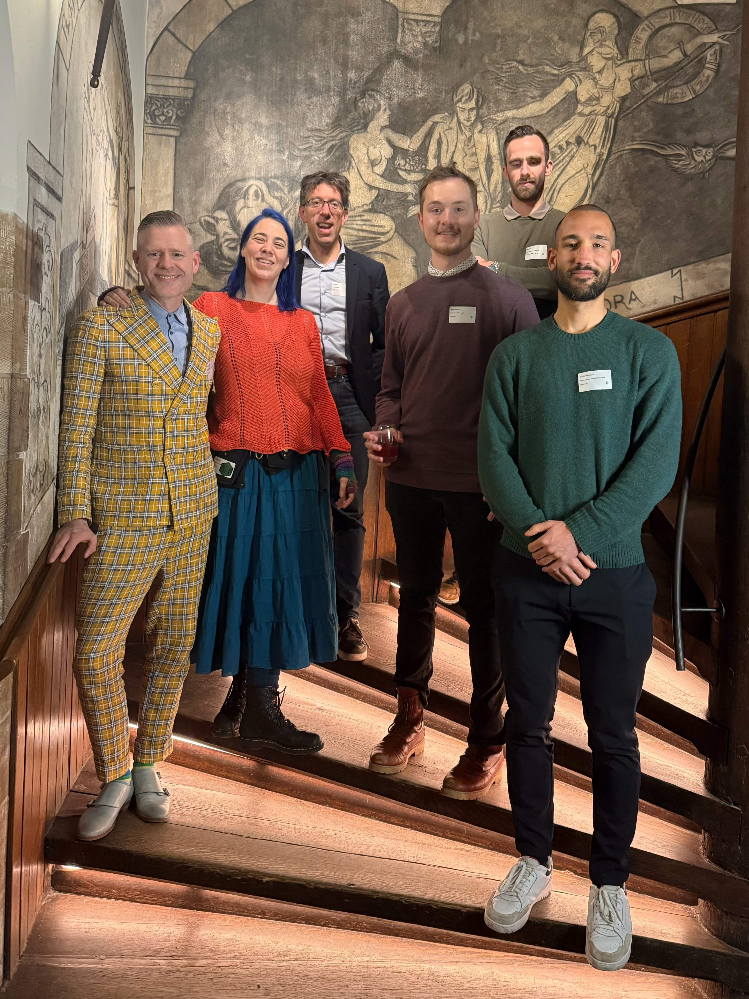

The team attended the 8th annual [Perspectives on Scientific Error](https://perspectivesonscientificerror2026.wordpress.com/) conference February 11-13 in Leiden and held an unofficial metacheck hackathon on the final day. PhD student Raphael Merz presented a poster on "From Detection to Correction: A Hybrid Rule–NLP Approach to Misinterpretations of Nonsignificant p Values".

All of the talks and posters were great, but everyone especially enjoyed Leif Nelson's keynote on "Finding Lies from the People Who Create the Truths". Attila Simkó's talk on "Automating Code Reproducibility" was also especially relevant to our projects. 

